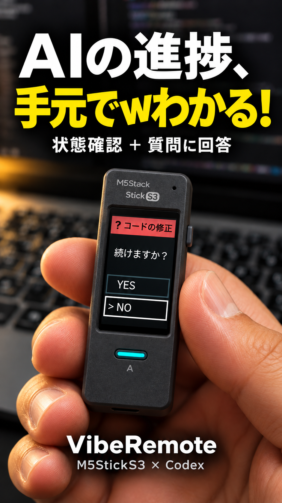

# VibeRemote · M5StickS3

<p align="center">
  
  <br><sub>利用イメージ（AI生成）。実機の外観・画面表示とは一部異なります。</sub>
</p>

PCから離れている間も、M5Stack StickS3でCodexの状態を確認し、選択式の質問に回答するProductです。
**B短押しで選択、Aで決定、B長押しでセッション一覧**。PCとはBluetooth LEで接続します。
従来のPlus2版と同じ共通C++アプリを使用し、S3の2ボタンに操作を割り当てます。

## AIに導入を頼む

ローカルのファイルと端末を操作できるAIへ、このREADMEとリポジトリURLを渡し、次のように依頼してください。

```text
https://github.com/ThousandsOfTies/GarVibeRemote-M5StickS3
を、このWindows PCとM5Stack StickS3（K150）へ導入してください。
READMEの「導入を担当するAIへ」、AGENTS.md、docs/INSTALL.mdを読んで進めてください。
シミュレータは省略し、実機への書き込み、BLE接続、Codex状態通知、
実機で選んだ回答が元のチャットへ戻るところまで確認してください。
既存ファームウェアはバックアップしてください。
監視するチャットと範囲は私に確認し、USBポート・BLEアドレスは実際の環境から取得してください。
USB接続、必要なダウンロードモード操作、ペアリング番号の照合、実機ボタンの操作は私に案内し、
そのほかの準備・設定・サービス起動は進めてください。
不足があれば、完了した範囲と残る条件を具体的に報告してください。
```

通常の実機導入には、**WebPanel、WASM、Emscripten、WSLは不要**です。
質問連携・セッション監視の起動には、ローカルCodex Appの実行環境が必要です。
別のAIや通常のPowerShellだけで準備する場合は、最後の監視起動をCodex Appへ引き継いでください。

## 必要なもの

| 項目 | 条件 |
| --- | --- |
| 本体 | **M5Stack StickS3（K150）**。StickC Plus2や他のS3ボードにはこの成果物を書き込まない |
| PC | WindowsとBLE対応Bluetoothアダプター |
| USB | データ通信対応ケーブル。導入・書き込み時に使用 |
| ツール | Git、Python 3.11以降、Node.js 24以降とnpm、ビルド依存の取得用インターネット接続 |
| 監視対象 | ローカルCodex App。質問回答・複数チャット監視にはAppの接続環境が必要 |
| 書き込み | GARのESP32-S3対応版。導入AIは利用可能なCLI・ターゲット設定を確認する |

PCと本体の無線通信はBLEです。SPPのCOMポートやWi-Fi・社内LAN接続は使いません。

## 導入を担当するAIへ

詳細コマンドは[Windows導入手順](docs/INSTALL.md)、基板仕様は
[sources/board-m5sticks3](sources/board-m5sticks3)、検証実績は[VALIDATION.md](docs/VALIDATION.md)を参照してください。

1. **取得・環境確認**
   次を実行し、既存の接続設定・サービス・ポート競合も確認します。

   ```powershell
   git clone --recurse-submodules https://github.com/ThousandsOfTies/GarVibeRemote-M5StickS3.git
   cd GarVibeRemote-M5StickS3
   python tools/product.py validate
   python scripts/setup_remote.py doctor
   python scripts/setup_remote.py prepare
   ```

   既に取得済みなら作業中の変更を保全し、必要なsubmoduleだけを初期化してください。
   設定ファイルのトークンやAPI接続環境の値をログ・チャット・Gitへ出さないでください。

2. **バックアップ・ビルド・実機へ書き込み**
   USBポート一覧とチップ識別情報でStickS3を特定します。既存フラッシュを読み取り専用で
   バックアップし、Git管理外へ保存してから書き込みます。COM番号は固定しないでください。
   ダウンロードモードが必要なら、USB接続のまま電源ボタンを緑LED点滅まで長押しして離すよう案内します。

   GARへこのProductをローカルworkspaceとして登録し、ESP32/esptoolターゲットと検出したUSBポートを選択します。
   設定コマンドはそのGAR版の `gar --help`、`gar config --help` で確認してください。
   以下の `WORKSPACE` は登録したworkspace名に置換します。

   ```powershell
   gar target build --workspace WORKSPACE
   gar target deploy --workspace WORKSPACE
   gar target diag --workspace WORKSPACE --json
   ```

   Pythonビルド入口は `scripts/product-target-build.py`。ESP32-S3の識別情報を含む
   書き込み用bundleを生成します。GAR側にはPython hookとS3 flash profileへの対応が必要です。
   コマンドが非対応なら、Plus2のオフセットや成果物を流用せず、GARの不足を報告・修正してください。
   書き込み成功と起動成功は別に確認します。起動しなければ電源ボタンを短く1回押すよう案内し、
   画面とUSBの `deviceInfo`（device=m5sticks3、135×240）を確認してください。

3. **Codex監視設定**
   対象のチャットID・プロジェクトと、監視範囲を確認して `configure` を実行します。
   チャットIDは現在のCodex環境から取得し、取得できなければ確認してください。
   単一チャットは `single`、同じプロジェクトは `project`、全プロジェクトは `local`、
   指定チャット群は `manual`。無断で範囲を広げないでください。
   設定は `artifacts/connection/local.json` に保存します。Hook導入は任意で、通常のApp監視の必須条件ではありません。

4. **ペアリングと3サービスの起動**
   `ble-scan` でアドレスを取得し、Windowsの表示名 **M5StickS3** を確認します。
   必要な番号照合はユーザーへ案内します（BでYESを選択、Aで決定）。固定PINは使いません。
   PC状態ブリッジ `bridge`、質問監視 `questions`（複数監視なら `sessions`）、
   実機中継 `device --transport ble --port <検出したアドレス>` をそれぞれ起動します。
   既存の正常なサービスは再利用し、重複起動しないでください。
   `questions` / `sessions` はCodex Appの `CODEX_APP_TOOLS_PIPE_PATH` を引き継ぐ必要があります。
   Windowsでバックグラウンド起動する場合はウィンドウを非表示にし、個別ログとPIDを保存してください。

5. **導入完了の確認**
   `doctor` のブリッジ到達・監視準備完了、中継の `device-ready`、実機の状態表示を確認します。
   B長押しで一覧、B短押しで選択、Aで決定の操作を試し、実際の選択式質問へ本体から回答して
   元のチャットに一度だけ届くことを確認します。合成した回答をユーザーの回答として送らないでください。
   BLEの切断・再接続でも最新状態へ戻ることを確認し、未確認項目を残してください。

実機への書き込み・画面起動・USB通信・ペアリング・BLE経由の2セッション状態通知は確認済みです。
本番チャットへの実機回答と長時間の安定動作は、各環境で確認してください。
`doctor` の一部表示は静的な実装段階であり、そのPCでの通信成功を保証しません。

## PC再起動後の再接続

ファームウェアの再書き込みやペアリングのやり直しは通常不要です。本体の電源を入れ、
Codex Appで対象チャットを開き、3サービスを起動し直します。Windows自動起動は設定していません。

このProductには[接続復旧スキル](skills/viberemote-connect/SKILL.md)があります。
Codexが `~/.agents/skills` を参照する環境では、Productルートから次のように登録できます。
既存の同名スキルがある場合は上書きせず、リンク先を確認してください。

```powershell
New-Item -ItemType Directory -Force "$env:USERPROFILE/.agents/skills" | Out-Null
New-Item -ItemType Junction -Path "$env:USERPROFILE/.agents/skills/viberemote-connect" -Target (Resolve-Path skills/viberemote-connect).Path
```

登録後、必要ならCodex Appを再起動し、**「VibeRemoteと接続して」** と依頼してください。
Productフォルダーはリンク先になるため、移動・削除すると登録を直す必要があります。
スキルが未登録でも、このREADMEを渡して同じ復旧作業を依頼できます。

## 開発者向けWebシミュレータ

GAR管理では `gar sim build` → `deploy` → `start` → `diag`（各コマンドに
`--workspace WORKSPACE`）を使います。起動先は http://127.0.0.1:8774/ です。
以下は開発用の直接起動です。

実機と共通のC++/LVGLアプリをNode + WebAssemblyで実行します。
WASMはGitに含めません。WebPanel開発に限り、WindowsではWSLとEmscripten 3.1.64が必要です。

```powershell
python scripts/build.py --wsl Ubuntu-26.04
python scripts/simulate.py --port 8773
# http://127.0.0.1:8773/
```

Linuxでは `python3 scripts/build.py --bootstrap` で固定SDKを準備できます。
WindowsのWSLビルドは `~/.cache/gar-ui/emsdk/emsdk_env.sh` があれば読み込みます。
停止は起動したターミナルでCtrl+C。HTTPはPC内だけで待ち受けます。
通常起動は本番データの閲覧専用です。別途 `python scripts/setup_remote.py simulator-feed --panel-port 8774` を起動するとlocalhost:8775から受信します。実チャットへ回答しません。

シミュレータは画面、スクロール、複数セッション、選択・ACK等を確認しますが、
実機と同じBleUart.hの接続・暗号化要求・購読判定・送受信処理を実行します。
NimBLE / FreeRTOSの使用APIをホスト代替に置き換え、認証・購読・再接続を制御します。
実際の暗号処理、無線、WindowsのBLEスタックは再現しません。詳細は[検証経路](docs/SIMULATION_PATH.md)を参照してください。

## 操作

| 実物のキー | アプリの操作 |
| --- | --- |
| A短押し | 決定 |
| B短押し | 次の選択肢／次のセッション |
| Bを0.7秒長押し | セッション一覧／一覧から戻る |

WebPanelの本体ボタンを押すか、ボタンへフォーカスしてA/Bキーを使います。
側面リセットはアプリの3個目のボタンとして使いません。液晶は非タッチです。

## 構成とAIへの引き継ぎ

```text
product.json                 組み合わせ・アプリ設定
hardware/binding.json        使用するLCDとA/Bの選択
sources/
  gar-vibe-remote/            共通UI・JSONL・セッション・回答処理（submodule）
  gar-tools/                  ビルド・Web Components（submodule）
  board-m5sticks3/            公式基板定義・USB/LCDアダプター（submodule）
firmware/sticks3/
  include/ButtonMapping.h    S3の2ボタンを共通アプリ入力に変換（PCも同じものを使用）
  src/main.cpp               基板とアプリの接続
simulation/                  WebPanel・C++ホスト入口・模擬PC・HTTP
scripts/                     再現可能なビルドと開発用起動
tools/product.py             共通compositionへの入口
transports/ble/              BLEのUUID設定とプロトコル契約
docs/                       構成・実装段階・検証範囲
tests/                      共通C++アプリを使う回帰確認
```

まず[AGENTS.md](AGENTS.md)と[実装段階](docs/STATUS.md)を読んでください。
Plus2版を参照し続ける絶対パスや、別ProductのWASMのコピーは使用しません。
共有リポジトリの更新を先にpushし、そのコミットをProductで固定します。

## 確認

```powershell
python tools/product.py validate
node --test tests/*.test.cjs
```

テストには生成済み `simulation/runtime` が必要です。
外観部品はgar-toolsの `web-simulator/tests/sticks3-browser/` で、設定の異なる2台を独立確認できます。

## ライセンス

独自コードはMIT。共通アプリの日本語フォントはSIL OFL 1.1です。
依存ライブラリのライセンスは各リポジトリに従います。
